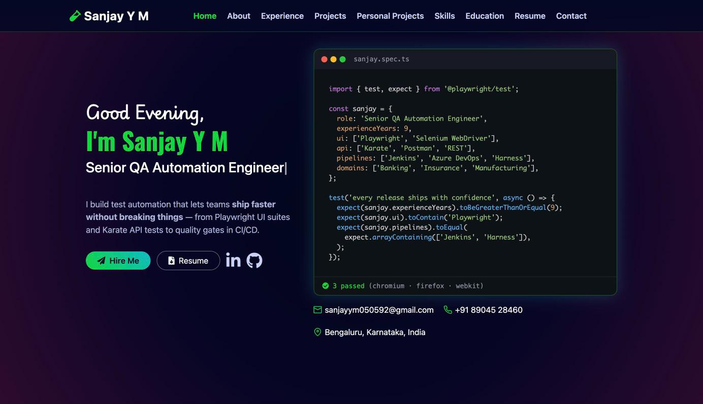
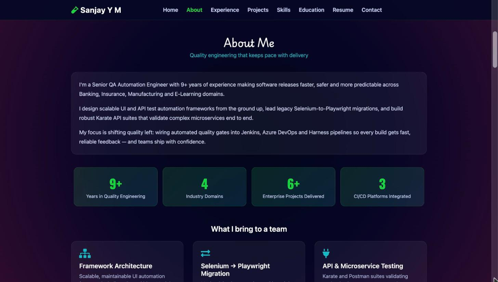
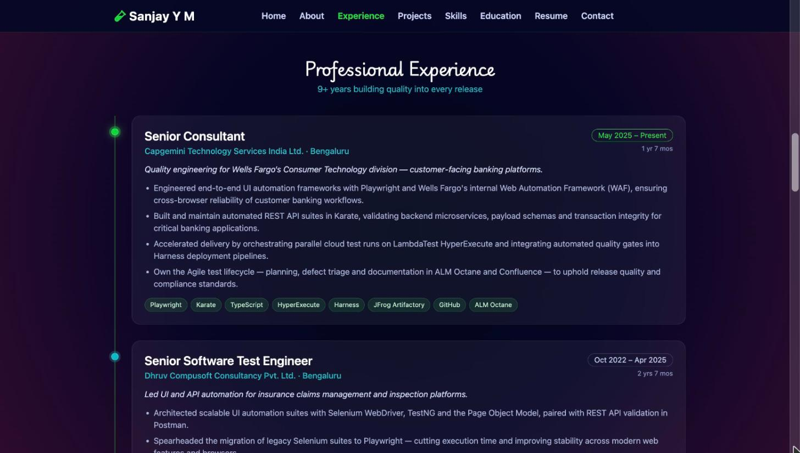
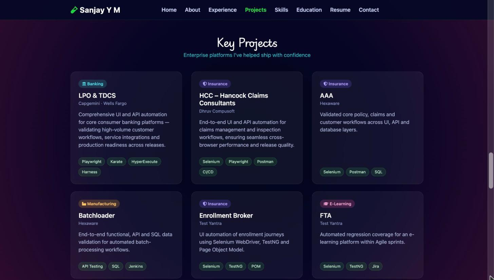
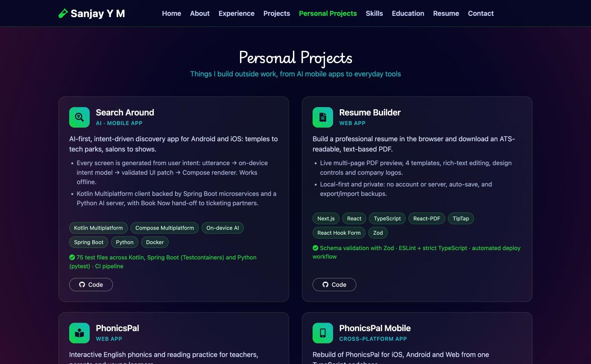
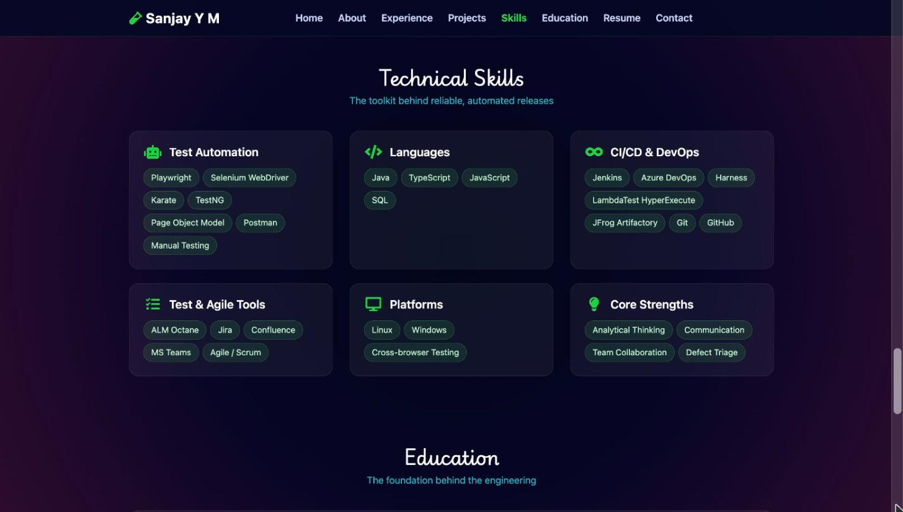
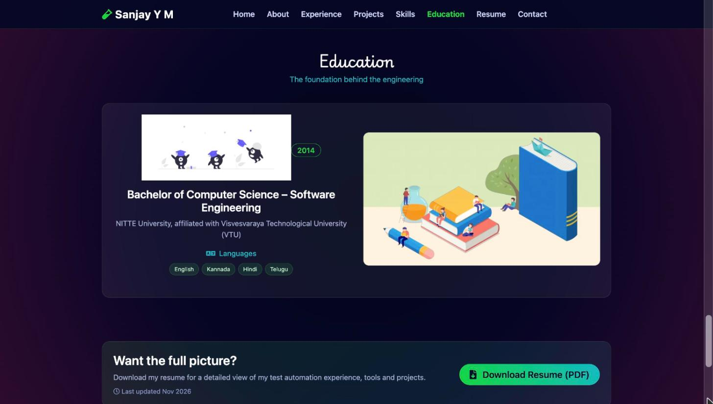
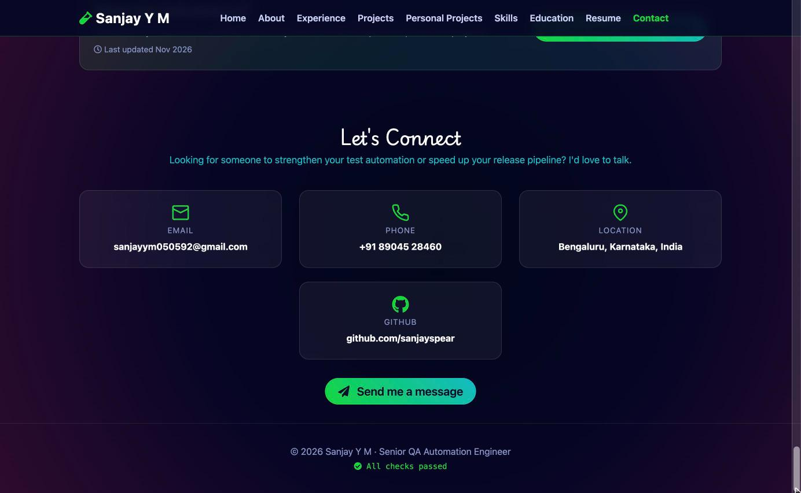

# Sanjay Y M — Portfolio

Personal portfolio website for **Sanjay Y M, Senior QA Automation Engineer**.
It's a single scrolling page built with **Angular 16**, Bootstrap 4 and PrimeNG, and hosted free on GitHub Pages.

### 🔗 Live site: **https://sanjayspear.github.io/My-Portfolio-App/**

[](https://github.com/sanjayspear/My-Portfolio-App/actions/workflows/deploy.yml)

[](https://sanjayspear.github.io/My-Portfolio-App/)

**Sections:** Home · About · Experience · Projects · Personal Projects · Skills · Education · Resume · Contact

---

## Contents

1. [Live site and sharing](#1-live-site-and-sharing)
2. [Screenshots](#2-screenshots)
3. [Tech stack](#3-tech-stack)
4. [Quick start](#4-quick-start)
5. [Where everything lives](#5-where-everything-lives)
6. [What updates itself](#6-what-updates-itself)
7. [Updating your resume PDF](#7-updating-your-resume-pdf)
8. [Updating content (jobs, projects, skills, contact)](#8-updating-content)
9. [Build and deploy](#9-build-and-deploy)
10. [Troubleshooting](#10-troubleshooting)

---

## 1. Live site and sharing

**Portfolio URL:** https://sanjayspear.github.io/My-Portfolio-App/

The site is public, so anyone can open it on a phone or computer without a GitHub account.

### Getting the URL from GitHub

Any of these show the live link:

| Where on GitHub | Steps |
|---|---|
| **Settings → Pages** (most direct) | Open the repo → **Settings** (top tab) → **Pages** (left sidebar, under *Code and automation*). The top of the page says **"Your site is live at https://…"**. Click **Visit site**, or copy the link. |
| **Deployments** (repo home page) | On the repo's main page, find **Deployments** in the right-hand sidebar → click **github-pages** → each deployment shows **View deployment** with the live link. |
| **Actions** | **Actions** tab → open the latest **Deploy portfolio** run (green ✔) → the **deploy** box shows the URL. |
| **Build it yourself** | The pattern is `https://<username>.github.io/<repo-name>/`, so here it's `https://sanjayspear.github.io/My-Portfolio-App/`. |

> **Tip: show the link on the repo's main page.** On the repo home, click the ⚙️ gear next to
> **About** (right sidebar) → tick **"Use your GitHub Pages website"** → **Save changes**.
> The live link then appears at the top of the repository for anyone who visits it.

### Sharing the link

1. Copy the URL from one of the places above. In Chrome you can also click the address bar on
   the live site and press `Cmd + C`.
2. Paste it (`Cmd + V`) into WhatsApp, email, SMS, LinkedIn, Slack, or wherever you're sending it.

**Ready-to-send message:**

> Hi! I've put together my portfolio. Have a look and let me know what you think:
> https://sanjayspear.github.io/My-Portfolio-App/

**For recruiters, also add the link to:**

| Place | How |
|---|---|
| **LinkedIn** | Edit profile → **Contact info → Website** (type: *Portfolio*). You can also add it under **Featured → Add → Link**. |
| **Resume** | Next to your email and phone in the header. Then run `npm run update-resume` with the new PDF (see [section 7](#7-updating-your-resume-pdf)). |
| **Email signature** | Add a line such as *Portfolio: https://sanjayspear.github.io/My-Portfolio-App/* |
| **In person / events** | In Chrome on the live site: **⋮ menu → Cast, save and share → Create QR code**, then download the QR image to print or show on your phone. |

> ℹ️ WhatsApp and Slack show the page title and description when you paste the link, but no
> preview image yet, because no social preview image is set.

---

## 2. Screenshots

Captured from the live site (desktop, 1440 px wide).

**Home:** a typed role headline and a Playwright test written about me, with a "3 passed" result.


**About:** summary, auto-calculated stats and core strengths.


**Experience:** a timeline with auto-calculated durations. The current role is marked green.


**Key Projects:** enterprise projects tagged by domain and tools.


**Personal Projects:** side projects with live demo and code links, plus testing/CI facts for each.


**Technical Skills:** grouped toolkit.


**Education and Resume download:** shows the "Last updated" month automatically.


**Contact:** clickable email, phone and GitHub.


> To refresh these after a redesign, take new screenshots of the live site and save them over
> the files in `docs/screenshots/`, keeping the same names.

---

## 3. Tech stack

### Application

| Layer | Technology | Used for |
|---|---|---|
| Framework | **Angular 16.2** (NgModule-based) | Components, templates, data binding |
| Language | **TypeScript 5.1** | All application code, typed content model in `profile.ts` |
| Reactive runtime | RxJS 7.8, Zone.js 0.13 | Angular's change detection and async handling |
| Styling | **SCSS**, **Bootstrap 4.6** | Layout grid, navbar, responsive breakpoints, custom dark "glass" theme |
| UI library | PrimeNG 17, PrimeIcons 7, PrimeFlex 3 | Icons (email, phone, map marker) and utility classes |
| Icons | Font Awesome 5 (CDN) | Section, skill and domain icons |
| Fonts | Google Fonts: *Playwrite GB S*, *Oswald* | Section headings and the name/stat typography |
| Animations | **AOS 2.3** (Animate On Scroll) | Fade, zoom and flip reveals while scrolling |
| Typing effect | **Typed.js 2.1** | Greeting and rotating job titles on Home |
| Code highlighting | **highlight.js 11** (TypeScript grammar only) | The `sanjay.spec.ts` code window |
| Navbar behaviour | jQuery 3.7 and the Bootstrap JS bundle | Mobile menu collapse/expand |

### Build, test and tooling

| Tool | Used for |
|---|---|
| **Angular CLI 16** (webpack builder) | Dev server with live reload, production builds, bundle budgets |
| **Node.js and npm** | Dependency management and scripts (`start`, `build`, `update-resume`) |
| Custom Node script: `scripts/update-resume.mjs` | Validates and swaps the resume PDF and stamps the "Last updated" date |
| Karma and Jasmine | Unit-test runner (Angular defaults) |
| **VS Code** | Editor (recommended extensions in `.vscode/`) |
| **Git and GitHub CLI (`gh`)** | Version control, repo creation and authentication |

### Hosting and CI/CD

| Service | Used for |
|---|---|
| **GitHub Pages** | Free static hosting of the built site |
| **GitHub Actions** (`.github/workflows/deploy.yml`) | On every push to `main`: `npm ci`, then production `ng build` with the right base path, then upload the artifact, then deploy to Pages |
| Actions used | `actions/checkout`, `actions/setup-node` (Node 18), `actions/upload-pages-artifact`, `actions/deploy-pages` |

### Design approach

- **Content as data:** every piece of personal content is in one typed file
  (`src/app/data/profile.ts`). Components only render it.
- **Never stale:** years of experience, job durations, counts and the copyright year are
  calculated in the browser from dates (`src/app/data/date-utils.ts`).
- **Lean bundle:** highlight.js loads only the TypeScript grammar. The main bundle is about 350 KB
  (about 95 KB gzipped).

---

## 4. Quick start

**Needs:** [Node.js](https://nodejs.org) (LTS recommended) and VS Code.

```bash
# open the project in VS Code
code ~/Documents/My-Porfolio-App

# in the VS Code terminal (Ctrl + `):
npm install --legacy-peer-deps   # first time only
npm start                        # → open http://localhost:4200
```

The page reloads by itself whenever you save a file. Press `Ctrl + C` in the terminal to stop it.

> **Why `--legacy-peer-deps`?** Some libraries in this project ask for newer Angular versions
> than it uses. This flag tells npm to install anyway. It works fine.

---

## 5. Where everything lives

```
My-Porfolio-App/
├── src/
│   ├── app/
│   │   ├── data/
│   │   │   ├── profile.ts        ← ★ ALL YOUR CONTENT — edit this file
│   │   │   └── date-utils.ts     ← year/duration calculations (no need to touch)
│   │   ├── home/                 ← hero section + Playwright code snippet
│   │   ├── about/                ← bio, stat cards, "What I bring" cards
│   │   ├── experience/           ← job timeline
│   │   ├── projects/             ← work project cards
│   │   ├── personal-projects/    ← personal project cards (demo + code links)
│   │   ├── skills/               ← skill groups
│   │   ├── education/            ← degree + languages
│   │   ├── resume/               ← download button
│   │   ├── contact/              ← email / phone / location cards
│   │   ├── header/ · footer/     ← top menu and footer
│   ├── assets/
│   │   ├── resume/Sanjay-Y-M-Resume.pdf   ← the PDF visitors download
│   │   ├── Images/ · vedio/                ← images and the education video
│   ├── index.html                ← browser tab title and default description
│   └── styles.scss               ← shared colours, cards, buttons
├── scripts/update-resume.mjs     ← powers `npm run update-resume`
└── package.json
```

**You'll almost always only edit `src/app/data/profile.ts`.**
In VS Code press `Cmd + P`, type `profile.ts` and press Enter.

The top of that file has a **QUICK UPDATE** block:

```ts
export const CAREER_START_DATE = '2017-09';   // years of experience are counted from this
export const RESUME_FILE = 'Sanjay-Y-M-Resume.pdf';
export const RESUME_LAST_UPDATED = '2026-11'; // set automatically by update-resume
const CI_CD_PLATFORMS = ['Jenkins', 'Azure DevOps', 'Harness'];
```

---

## 6. What updates itself

These are calculated in the visitor's browser each time the page loads, so they stay
correct **without editing or redeploying anything**:

| On the site | Calculated from | Example |
|---|---|---|
| Years of experience (About text, stat card, Experience subtitle, code snippet, search/share description) | `CAREER_START_DATE` | `9+` today → `10+` from **1 Sep 2027** → `11+` from Sep 2028 … |
| Each job's duration | the job's `start` / `end` | Capgemini: "1 yr 7 mos", which keeps growing |
| "Present" on the current job | `end: null` | `May 2025 – Present` |
| Projects stat (`6+`) and Domains stat (`4`) | the `projects` list | add a project → the stat goes up |
| CI/CD Platforms stat (`3`) | `CI_CD_PLATFORMS` | |
| Footer copyright year | today's date | © 2026 → © 2027 |

---

## 7. Updating your resume PDF

### Recommended: one command

1. Export your new resume as a **PDF** (for example to `~/Downloads`).
2. In the VS Code terminal, from the project folder:

   ```bash
   npm run update-resume -- ~/Downloads/Sanjay-Y-M-Resume.pdf
   ```

   > Tip: type `npm run update-resume -- ` (with the trailing space), then **drag the PDF from
   > Finder into the terminal** to paste its full path.

3. You'll see:

   ```
   ✔ Resume updated
       to:   src/assets/resume/Sanjay-Y-M-Resume.pdf (45 KB)
       "Last updated" on the site set to 2026-11
   ```

4. Check it at http://localhost:4200/#Resume, then [build and deploy](#9-build-and-deploy).

**What the command does:**
- Checks that the file exists and really is a PDF. If anything is wrong it stops and changes nothing.
- Replaces `src/assets/resume/Sanjay-Y-M-Resume.pdf`. Visitors always download it under that name, whatever your file was called.
- Sets the **"Last updated …"** note in the Resume section to the current month.

### Manual alternative

1. Copy your PDF over `src/assets/resume/Sanjay-Y-M-Resume.pdf`, keeping exactly that file name.
2. In `profile.ts`, set `RESUME_LAST_UPDATED` to the current month, e.g. `'2027-03'`.

---

## 8. Updating content

All of these are edits to `src/app/data/profile.ts`. Save the file and the browser updates.
Dates always use the format **`'YYYY-MM'`**, e.g. `'2027-03'` for March 2027.

### Changing jobs

1. Find your current job in `experience` and change `end: null` to its last month:
   ```ts
   end: '2027-03',
   ```
2. Add the new job at the **top** of the `experience` list:
   ```ts
   {
     company: 'New Company Pvt. Ltd.',
     location: 'Bengaluru',
     role: 'Lead SDET',
     start: '2027-04',
     end: null,                       // null = current job, shows "Present"
     summary: 'One line about the team or product.',
     highlights: [
       'What you built or improved…',
       'Another achievement…',
     ],
     tech: ['Playwright', 'Karate', 'GitHub Actions'],
   },
   ```
   The timeline, the green "current" dot and the durations update automatically.

### Adding a project

Add an entry to the `projects` list:

```ts
{
  name: 'Project Name',
  domain: 'Banking',                // Banking | Insurance | Manufacturing | E-Learning
  company: 'Company · Client',
  description: 'What you tested and why it mattered.',
  tags: ['Playwright', 'Karate'],
},
```

A new domain name works too. It gets a default briefcase icon, and the Domains stat counts it.

### Adding a personal project

Add an entry to the `personalProjects` list (cards appear in list order):

```ts
{
  name: 'My New App',
  type: 'Web App',                     // badge text: Web App, Mobile App, PWA, …
  icon: 'fas fa-rocket',               // any Font Awesome 5 icon
  tagline: 'One sentence about what it does.',
  highlights: [
    'Most impressive feature or technical point.',
    'Second point.',
  ],
  tech: ['React', 'TypeScript'],
  quality: '40 Playwright tests · CI on every push',   // optional; testing/CI facts
  repo: `${GITHUB}/my-new-app`,
  demo: 'https://sanjayspear.github.io/my-new-app/',    // optional; leave '' to hide
},
```

> ⚠️ Only add a `demo` link that works for people who **aren't logged in**. Open it in a
> private/incognito window first (`Cmd + Shift + N` in Chrome). Vercel projects, for example,
> ask visitors to log in unless Deployment Protection is turned off. GitHub Pages links are
> always public.

### Other common edits

| I want to… | In `profile.ts` |
|---|---|
| Add a skill | Add it to the matching group's `items` in `skills` |
| Add a CI/CD platform | Add it to `CI_CD_PLATFORMS` (QUICK UPDATE block) |
| Add **LinkedIn** | Fill in `linkedin: 'https://…'`. The icon and contact card appear only when it's set. GitHub is already set from `GITHUB` |
| Change phone, email, location | `email`, `phone` (shown), `phoneHref` (digits for the call link), `location` |
| Edit the bio | the `about` paragraphs. Keep `${YEARS}+` wherever you mention experience so it stays automatic |
| Change the rotating titles on Home | the `roles` list |
| Edit "What I bring to a team" | the `strengths` list (icons are [Font Awesome 5](https://fontawesome.com/v5/search?m=free) class names) |

> ⚠️ Text is inside quotes. If your text contains an apostrophe (`'`), either write `\'`
> or wrap the whole text in backticks `` ` `` like the `about` paragraphs.

---

## 9. Build and deploy

```bash
npm run build
```

This creates the finished website in `dist/portfolio/`. You can upload that folder to any static
host (Netlify, Vercel, GitHub Pages, …).

### Publishing to GitHub Pages (automatic)

The site is published by **GitHub Actions** (`.github/workflows/deploy.yml`).
**Every push to `main` rebuilds and republishes the live site**, usually within 2 minutes.

```bash
# after editing content or running update-resume:
git add -A
git commit -m "Update resume"      # describe what changed
git push
```

- Watch progress: GitHub repo → **Actions** tab (green ✔ = live).
- Live URL: **https://&lt;username&gt;.github.io** (repo named `<username>.github.io`).
  Any other repo name is published at `https://<username>.github.io/<repo-name>/`, and the
  workflow sets the right base path automatically.
- Re-run without changes: **Actions → Deploy portfolio → Run workflow**.

You only need to push when **you** change content or the resume. Years and durations
update on the live site by themselves.

---

## 10. Troubleshooting

| Problem | Fix |
|---|---|
| `npm install` fails with `ERESOLVE … peer dependency` | Use `npm install --legacy-peer-deps` |
| `npm` fails with `EACCES: permission denied … ~/.npm` | Run once: `sudo chown -R $(whoami) ~/.npm`, then install again |
| `code: command not found` | In VS Code: `Cmd + Shift + P` → **Shell Command: Install 'code' command in PATH** |
| Port 4200 already in use | Stop the other terminal running `npm start`, or run `npx ng serve --port 4300` |
| Page is blank after an edit | Look at the terminal running `npm start`. It shows the exact file and line, usually a missing comma, quote or bracket in `profile.ts` |
| Old resume still downloads | Your browser has cached it. Hard refresh with `Cmd + Shift + R` |
| Live site didn't change after a push | Open the **Actions** tab. A red ✖ means the build failed, so click it to see the error. Then hard refresh the site with `Cmd + Shift + R` |
| Live site shows no styles or a blank page | The workflow sets the base path from the repo name automatically. If you renamed the repo, push any change (or **Actions → Deploy portfolio → Run workflow**) to rebuild |

### Other commands

| Command | What it does |
|---|---|
| `npm start` | Run locally with live reload |
| `npm run build` | Production build into `dist/portfolio/` |
| `npm run update-resume -- <file.pdf>` | Replace the resume PDF and its "Last updated" date |
| `npm test` | Run unit tests (Karma) |
